# KC-SVSDF

**Real-time Whole-Body Motion Planning for Mobile Manipulators Carrying Arbitrarily Shaped Payloads via Kinematically-Coupled SVSDF**

> **Code status:** this repository currently hosts the project introduction and demos only. The source code will be published here later after the paper is accepted.

## Introduction

Mobile manipulators are increasingly asked to transport large, non-convex payloads through cluttered environments. Planners that approximate the payload with bounding spheres lose feasible space, while per-link swept-volume costs can produce conflicting gradients through shared joints and stall optimization.

KC-SVSDF is a real-time whole-body planning framework that keeps the true payload geometry in the loop and produces coherent whole-body motion.

  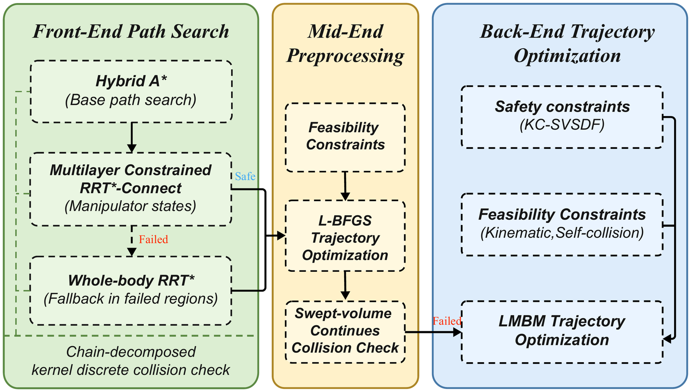

- **Front-end: chain-decomposed kernel collision checking.** The robot and payload are represented with voxelized mesh geometry. Storage scales linearly with the per-joint sample counts rather than multiplicatively, and queries are fast bit-level operations.
- **Mid-end: trajectory preprocessing.** The front-end path becomes a continuous trajectory that enforces smoothness, kinematic feasibility and self-collision avoidance. If it is collision-free, it runs directly and skips the back-end.
- **Back-end: KC-SVSDF optimization.** When refinement is needed, a Kinematically-Coupled Swept-Volume Signed Distance Field propagates collision-avoidance gradients along the kinematic chain to give consistent whole-body escape directions.

  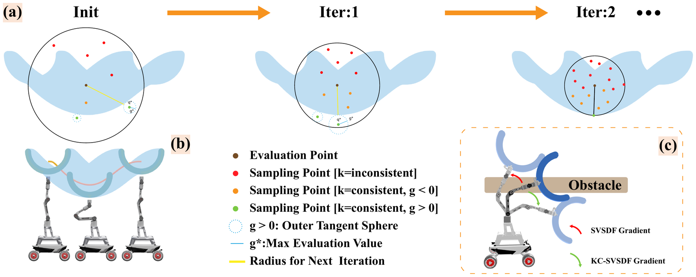

> All GIFs on this page play at 2× speed.

## Payload Shape Diversity

Four additional payloads were tested in the Tunnel scenario, over 50 trials each.

| Arc (94% success) | Bendlinear (96% success) |
|:---:|:---:|
| 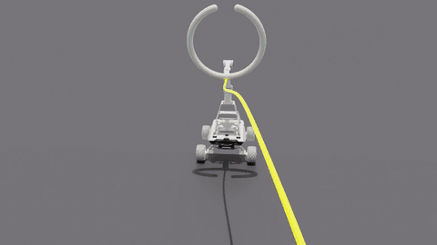 | 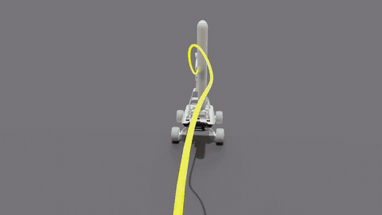 |
| **Cross (100% success)** | **Table (90% success)** |
| 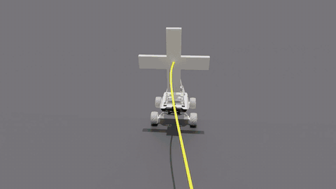 | 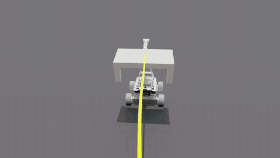 |

## Simulation Benchmark

### Benchmark 1: Tunnel, T-shaped payload

| Ours | TOPAY | REMANI |
|:---:|:---:|:---:|
| 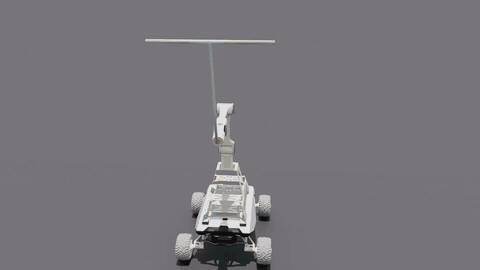 | 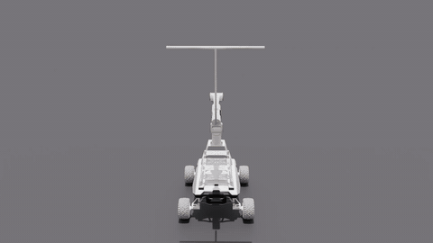 | 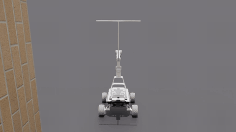 |

### Benchmark 2: Forest, rectangular payload

| Ours | TOPAY | REMANI |
|:---:|:---:|:---:|
| 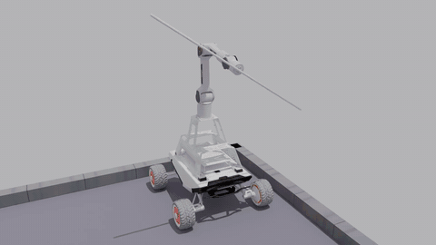 | 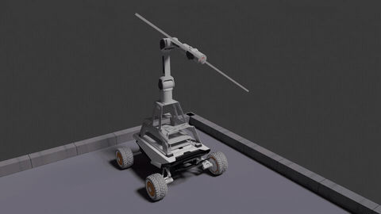 | 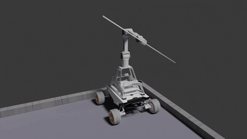 |

### Results

| Scenario | Method | Replan time per cycle (s) | Replan cycles | Success |
|:---|:---|:---:|:---:|:---:|
| Tunnel | **Ours** | 0.81 ± 0.62 | **5.12 ± 1.24** | **98%** |
| Tunnel | TOPAY | **0.26 ± 0.13** | 9.10 ± 5.78 | 20% |
| Tunnel | REMANI | 2.09 ± 0.58 | 6.56 ± 1.69 | 32% |
| Tunnel | NeuralSVCD | 6.80 ± 3.80 | 6.10 ± 1.40 | 97% |
| Forest | **Ours** | 1.08 ± 0.62 | **7.26 ± 1.14** | **94%** |
| Forest | TOPAY | **0.38 ± 0.13** | 33.58 ± 26.17 | 14% |
| Forest | REMANI | 2.56 ± 0.28 | 14.90 ± 3.26 | 28% |

## Real-World Experiments

The platform is an Agilex Piper 6-DOF arm on an Agilex Scout Mini differential-drive base. FAST-LIO2 with a Livox MID-360 LiDAR provides state estimation, and ROG-Map updates the 3D occupancy grid online.

### Scenario 1: Tunnel, rectangular payload

An elongated rectangular payload passes through a narrow corridor with two differently inclined beams and one vertical obstacle.

  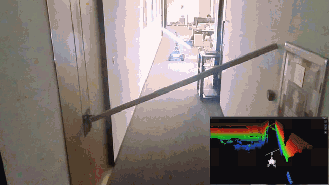

### Scenario 2: Forest, T-shaped payload

A T-shaped carbon-fiber payload moves through tight gaps among randomly placed wooden columns, with real-time replanning.

  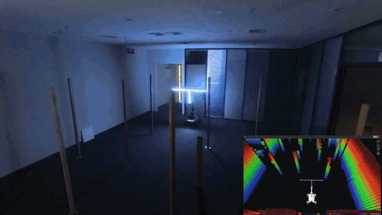

| Scenario | Front-end (s) | Mid-end (s) | Back-end (s) | Replan cycles | Replan time (s) | Back-end bypass |
|:---|:---:|:---:|:---:|:---:|:---:|:---:|
| Tunnel | 0.11 ± 0.04 | 0.32 ± 0.36 | 0.62 | 4 | 0.58 ± 0.35 | 75% |
| Forest | 0.10 ± 0.11 | 0.14 ± 0.17 | 0.26 ± 0.20 | 13 | 0.44 ± 0.37 | 38% |

All results come from one run per scenario.
